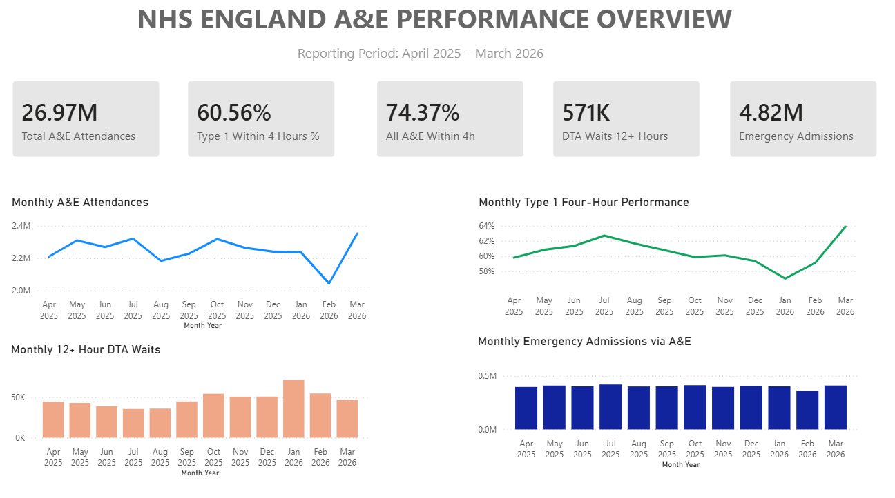
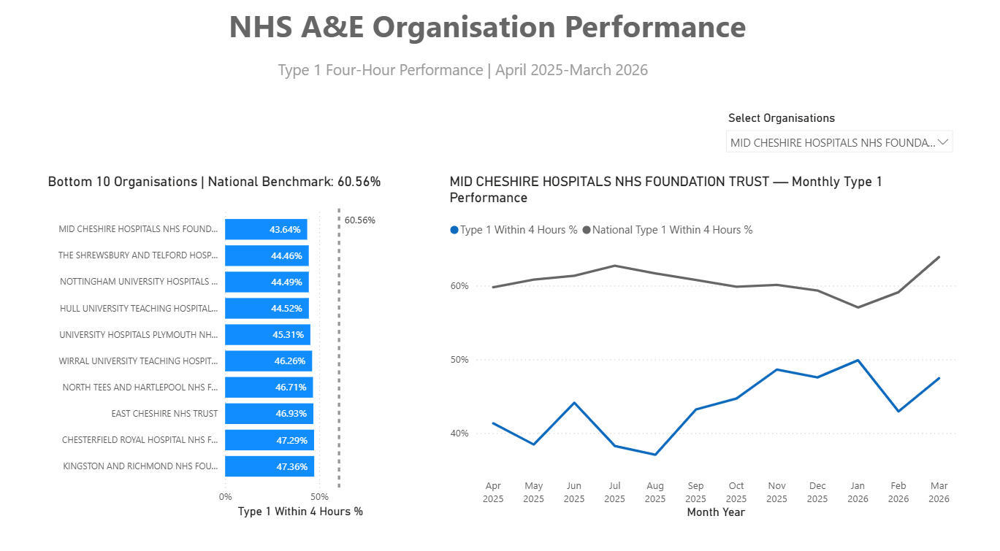

# NHS England A&E Performance Analysis

**SQL | MySQL | Power BI | DAX | Data Analytics**

## 1. Project Overview

This end-to-end data analytics project explores Accident and Emergency (A&E) performance across NHS organisations in England between April 2025 and March 2026.

The project uses SQL for data validation, transformation and exploratory analysis, followed by Power BI for data modelling, interactive reporting and visualisation.

The objective is to identify patterns in A&E demand, waiting-time performance, emergency admissions and organisation-level performance variation to support evidence-based operational decision-making.

## 2. Business Questions

- How does A&E attendance volume vary throughout the reporting period?
- How does four-hour waiting-time performance differ across department types?
- Which months experience the greatest pressure in terms of long decision-to-admit waiting times?
- Does emergency admission volume alone explain variations in long waiting times?
- How does Type 1 A&E performance vary across organisations?
- How do lower-performing organisations compare against national performance?

## 3. Tools and Technologies

| Tool | Purpose |
|---|---|
| MySQL | Data storage, validation, transformation and analysis |
| MySQL Workbench | Database management and SQL development |
| Power Query | Data extraction and preparation for reporting |
| Power BI Desktop | Data modelling and interactive dashboards |
| DAX | KPI calculations and dynamic benchmarking |
| GitHub | Project documentation and version control |

## 4. Dataset

**Source:** NHS England — A&E Attendances and Emergency Admissions 2025–26

**Reporting period:** April 2025 – March 2026

[Official NHS England dataset](https://www.england.nhs.uk/statistics/statistical-work-areas/ae-waiting-times-and-activity/ae-attendances-and-emergency-admissions-2025-26/)

| Dataset characteristic | Value |
|---|---:|
| Monthly CSV files | 12 |
| Raw records | 2,398 |
| National aggregate records | 12 |
| Organisation-level records | 2,386 |
| Unique organisations | 205 |
| Original columns | 22 |
| Numerical measures | 18 |

The dataset contains aggregated monthly organisation-level statistics covering A&E attendances, four-hour waiting times, booked appointments, emergency admissions and decision-to-admit waiting times.

### Metric Definitions and Scope

**Attendance and four-hour performance metrics in this project exclude separately reported booked appointments.** Consequently, these figures differ from inclusive NHS national headline statistics.

| Metric | Project scope | Including booked appointments |
|---|---:|---:|
| Annual A&E attendances | 26,969,593 | 27,976,025 |
| All-department four-hour performance | 74.37% | 74.93% |

The dataset contains 1,006,432 separately reported booked appointments.

Additional metric definitions:

- Four-hour performance is calculated using the ratio of aggregated attendance volumes rather than averaging individual percentages.
- Emergency admissions include admissions via A&E only.
- Decision-to-admit (DTA) waiting times measure waiting after the decision to admit, not the entire A&E patient journey.
- Organisation rankings and national benchmarks use consistent attendance definitions throughout the project.

## 5. Project Workflow

Raw CSV Data → MySQL Staging Table → Data Validation → Data Transformation → Exploratory Analysis → Power BI Data Model → Dashboard Development → Cross-Validation

### Data Import and Validation

The 12 monthly CSV files were imported into a MySQL staging table.

Data quality checks included:

- Record counts and reporting period completeness.
- Identification of national aggregate records.
- Duplicate organisation-month detection.
- Missing metadata and numerical values.
- Negative numerical values.
- Logical consistency between attendance and waiting-time measures.
- Reconciliation against national aggregate totals.

### Data Cleaning and Transformation

SQL views were created to preserve the original staging data while providing reusable, analysis-ready datasets.

Key transformations included:

- Excluding national aggregate records to prevent double counting.
- Converting reporting period strings into standard date values.
- Standardising column names.
- Identifying organisation name variations.
- Selecting the latest recorded organisation name using the ROW_NUMBER() window function.
- Validating record counts and numerical consistency after transformation.

### SQL View Architecture

| View | Purpose |
|---|---|
| vw_ae_organisations_base | Organisation metadata and reporting dates |
| vw_ae_performance_clean | Cleaned organisation-level performance records |
| vw_ae_organisation_names | Standardised organisation name lookup |
| vw_ae_performance_reporting | Final analysis-ready reporting dataset |

### Exploratory Data Analysis

SQL was used to investigate:

- Annual and monthly attendance volumes.
- Daily-normalised attendance demand.
- Department-level four-hour performance.
- Monthly Type 1 performance trends.
- Decision-to-admit waiting times.
- Emergency admission patterns.
- Organisation-level performance distributions.
- Top and bottom-performing eligible organisations.
- Organisation performance against national benchmarks.

SQL techniques included aggregation, joins, common table expressions, window functions, conditional logic, date functions and null-safe calculations.

## 6. Power BI Data Model

A star schema was implemented to support consistent filtering and dynamic KPI calculations.

| Table | Type | Records |
|---|---|---:|
| FactAEPerformance | Fact table | 2,386 |
| DimOrganisation | Organisation dimension | 205 |
| DimDate | Date dimension | 365 |

Both dimension tables have active one-to-many relationships with the fact table, using single-direction filtering.

The date dimension was created using DAX CALENDAR, with chronologically sorted month-year labels.

Power BI connects to the MySQL reporting views using Import mode. Column selection and data type configuration were performed in Power Query.

### DAX Measures

Key measures include:

- Total A&E Attendances
- Total Type 1 Attendances
- Type 1 Within 4 Hours %
- All Departments Within 4 Hours %
- DTA Waits 12+ Hours
- Emergency Admissions via A&E
- Annual Type 1 Attendances
- National Type 1 Within 4 Hours %
- Dynamic Organisation Trend Title

DAX calculations use aggregation, filter context, DIVIDE, CALCULATE, REMOVEFILTERS and conditional logic.

Power BI results were independently validated against SQL reference calculations.

## 7. Dashboard Preview

### National A&E Performance Overview

The national dashboard presents five core KPIs alongside monthly attendance, waiting-time and emergency admission trends.

| KPI | Annual result |
|---|---:|
| A&E attendances excluding booked appointments | 26,969,593 |
| Type 1 within four hours | 60.56% |
| All departments within four hours | 74.37% |
| DTA waits of 12+ hours | 570,957 |
| Emergency admissions via A&E | 4,818,823 |

### Organisation Performance

The organisation dashboard provides:

- Bottom 10 organisation rankings.
- A minimum annual Type 1 attendance threshold of 10,000.
- An annual national performance benchmark.
- Interactive organisation selection.
- Monthly organisation performance against national performance.
- Dynamic chart titles.

The attendance threshold is an exploratory analytical choice rather than an official NHS eligibility standard.

## 8. Key Findings

### Attendance Demand

- Approximately 26.97 million attendances were recorded within the project's metric scope.
- March 2026 recorded the highest monthly attendance volume, at approximately 2.35 million.
- February 2026 recorded the lowest monthly attendance volume.
- After accounting for different month lengths, August recorded the lowest average daily attendance volume.

This demonstrates the importance of normalising monthly volumes before comparing demand.

### Four-Hour Performance

| Department | Within four hours |
|---|---:|
| Type 1 | 60.56% |
| Type 2 | 95.53% |
| Other departments | 97.07% |
| All departments | 74.37% |

Aggregate performance was 13.81 percentage points higher than Type 1 performance, demonstrating how combined metrics can mask differences between department types.

January 2026 recorded the lowest monthly Type 1 performance at 57.04%, followed by an improvement to 63.89% in March 2026.

### Decision-to-Admit Waiting Times

- 570,957 waits of 12 hours or longer were recorded.
- January 2026 recorded the highest monthly volume, at 71,517.
- July 2025 recorded the lowest monthly volume, at 35,467.

January also recorded the lowest Type 1 four-hour performance, identifying a period that warrants further operational investigation.

### Emergency Admissions

Approximately 4.82 million emergency admissions occurred via A&E.

July recorded more emergency admissions than January, despite substantially fewer 12-hour DTA waits.

This suggests that admission volume alone is insufficient to explain the observed differences in long waiting times.

### Organisation Performance Variation

Among the 121 organisations meeting the annual Type 1 attendance threshold:

| Statistic | Performance |
|---|---:|
| Mean organisation performance | 60.31% |
| Median organisation performance | 60.11% |
| Minimum performance | 43.64% |
| Maximum performance | 92.39% |
| Performance range | 48.75 percentage points |

Mid Cheshire Hospitals NHS Foundation Trust recorded the lowest annual performance among eligible organisations and remained below the monthly national benchmark throughout the reporting period.

Organisation comparisons should be interpreted cautiously because service configuration, patient complexity and case mix may differ substantially.

## 9. Business Recommendations

- Investigate the operational factors associated with January's deterioration in waiting-time performance.
- Examine bed availability, staffing, patient acuity and discharge processes alongside admission volumes.
- Monitor Type 1 performance separately rather than relying exclusively on aggregate A&E performance.
- Use daily-normalised attendance volumes when comparing demand across months.
- Benchmark organisations against comparable peers with similar service characteristics.
- Investigate persistent performance gaps to identify potential improvement opportunities.

These recommendations identify areas for further investigation rather than establishing causal relationships.

## 10. Limitations

- Attendance and four-hour performance calculations exclude separately reported booked appointments.
- The analysis covers one year and cannot establish long-term trends or recurring seasonal patterns.
- Monthly aggregated data does not support patient-level or hourly analysis.
- Staffing, bed occupancy, patient acuity and discharge information are unavailable.
- Organisation comparisons do not adjust for differences in case mix or service configuration.
- The 10,000-attendance threshold is an exploratory analytical decision.
- Four-hour waiting-time performance is not a comprehensive measure of clinical quality.
- Source files may differ from subsequently revised NHS publications.

## 11. Repository Structure

    nhs-ae-performance-analysis/
    |
    |-- data/
    |   |-- raw/
    |   |   |-- 12 monthly CSV files
    |   |-- nhs_ae_attendances_2025_26.csv
    |
    |-- sql/
    |   |-- 01_data_import.sql
    |   |-- 02_data_validation.sql
    |   |-- 03_data_cleaning.sql
    |   |-- 04_exploratory_analysis.sql
    |   |-- 05_powerbi_data_prep.sql
    |
    |-- powerbi/
    |   |-- NHS_AE_Performance.pbix
    |
    |-- images/
    |   |-- national_overview.png
    |   |-- organisation_performance.png
    |
    |-- README.md

## 12. Reproducing the Project

Requirements:

- MySQL 8.0 or later.
- MySQL Workbench.
- Power BI Desktop.
- Appropriate MySQL connectivity components.

Instructions:

1. Execute the database creation statements in 01_data_import.sql.
2. Import the combined CSV using the MySQL Workbench Table Data Import Wizard.
3. Name the staging table ae_attendances_staging.
4. Complete the remaining inspection queries in the import script.
5. Execute SQL scripts 02–05 in numerical order.
6. Open the Power BI report.
7. Configure the MySQL connection for your own environment if refreshing the data.
8. Use a dedicated read-only database account where possible.
9. Compare the report results against the SQL reference values.

The Power BI file uses imported data, allowing the saved report to be explored without refreshing the original database connection.

No database credentials are included in the repository.

## 13. Skills Demonstrated

- Data quality assessment and validation
- SQL database management
- Data cleaning and transformation
- Exploratory data analysis
- SQL joins, views, CTEs and window functions
- KPI development and validation
- Dimensional data modelling
- DAX and filter context
- Interactive dashboard development
- Business interpretation and analytical communication
- Documentation and reproducibility

## 14. Data Attribution

Contains information from NHS England, licensed under the Open Government Licence v3.0, subject to applicable source-specific terms.

- [NHS England dataset](https://www.england.nhs.uk/statistics/statistical-work-areas/ae-waiting-times-and-activity/ae-attendances-and-emergency-admissions-2025-26/)
- [Open Government Licence v3.0](https://www.nationalarchives.gov.uk/doc/open-government-licence/version/3/)

This is an independent educational portfolio project and is not an official NHS England report.